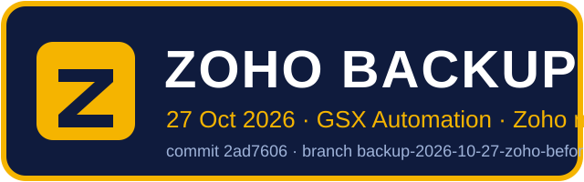

# 🟨 ZOHO BACKUP — 27 Oct 2026

Ye pura **Zoho niche ka flow** hai, bilkul jaisa 27 Oct 2026 ko GitHub pe chal raha tha (Claude-wealth niche pe shift karne se pehle).

| Kya | Kahan |
|---|---|
| Pura repo (code + jobs + clips + state) | git branch **`backup-2026-10-27-zoho-before-claude-wealth`** (commit `2ad7606`) |
| Code (autopilot/, tools/) | `code/` (is folder mein) |
| Settings: channel.yaml, problem bank, workflow, screenshots index | `settings/` |
| Zoho niche jo ab bhi chal sakta hai | `niches/zoho.yaml` (= yahi channel.yaml, ek bhi line nahi badli) |

## Wapas Zoho pe kaise jaana hai

Code ko kuch nahi karna. Sirf switch:

1. Repo ki root `channel.yaml` kholo -> `active_niche: zoho` likho -> Commit.
2. Ya ek run ke liye: Actions -> GSX Automation Shorts -> Run workflow -> niche = `zoho`.

Agar kabhi kuch bhi bigde: is branch se file wapas lo -> `backup-2026-10-27-zoho-before-claude-wealth`.

Note: is folder ke files sirf copy hain (yahan se kuch run nahi hota). `settings/autopilot.yml` `.github/workflows` ke bahar hai, isliye GitHub ise run nahi karta.
